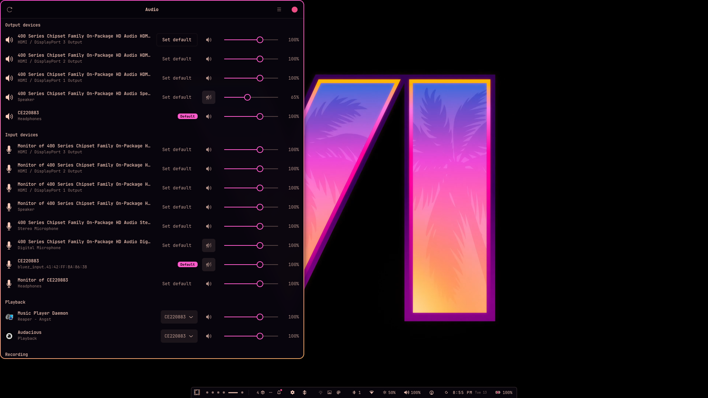

# TACOMA

**T**heme **A**ware **C**omprehensive **O**marchy **M**ixer **A**pplication — a
native GTK4 volume mixer for Omarchy. The `pavucontrol`-shaped hole in a Hyprland
setup, without pulling in a Qt/GNOME dependency or running a browser.



Talks to PipeWire (through `pipewire-pulse`) with `pactl`. No daemon of its own,
no API, no cost.

## What it does

- **Output devices** (sinks) and **input devices** (sources): volume, mute, and
  a one-click **Set default**.
- **Port selection** — switch a device between its ports (speakers / headphones /
  HDMI / internal vs headset mic). Unavailable ports are greyed out, and the
  active port is shown on the row.
- **Sound cards** — switch a card's profile (e.g. HiFi ↔ digital / Off, or
  A2DP ↔ headset on Bluetooth). Unavailable profiles are greyed out.
- **Playback** (per-app streams) and **Recording**: volume, mute, and a
  **route-to** dropdown to move a stream between devices.
- **Live updates** from `pactl subscribe` — changes made elsewhere (keybinds,
  the Omarchy OSD, other apps) appear immediately.
- **Omarchy theme-aware**: the default-device badge and accents come from the
  active theme's `colors.toml`.
- **Theme changes apply automatically** — a file monitor on the GTK config and
  theme directories re-reads the palette and theme CSS the moment Omarchy
  switches themes; no restart, no clicking. **Refresh theme** (menu) forces the
  same thing. (GTK caches the parsed named theme and never re-reads files Omarchy
  rebuilds in place under the same name, which is why apps normally need a restart.)

## Run

From the source tree:

```sh
~/Projects/omarchy-mixer/run.sh
```

## Install as a single file

Build a self-contained executable (a Python zipapp — one file, no pip, no
dependencies to install):

```sh
./build.sh              # -> dist/omarchy-mixer
./build.sh --install    # -> ~/.local/bin/omarchy-mixer
```

Then just:

```sh
omarchy-mixer
```

The artifact is a single ~12 KB file. Copy it anywhere on `$PATH`;
`~/.local/bin` is already on the Omarchy `PATH`. It reports its version:

```sh
omarchy-mixer --version
```

To uninstall, delete `~/.local/bin/omarchy-mixer`.

### It is not a static binary

The zipapp bundles the *app*, not Python or GTK. It runs on any system that
already has `python3`, PyGObject + GTK 4, and `pactl` — all of which an Omarchy
install has. A truly self-contained ELF (PyInstaller/Nuitka) is possible but
heavy and fragile with `gi`/typelibs, and would not fit the "small file in
`~/.local/bin`" goal.

### Alternative: pipx

`pyproject.toml` defines a console script, so this also works:

```sh
pipx install .
```


## Requirements

- `pactl` (from `pipewire-pulse`; on most Omarchy installs it is already there)
- GTK 4 + PyGObject (`python-gobject`)
- A running PipeWire/PulseAudio server

## Design

```
omarchy_mixer/
  audio.py    pactl wrapper: JSON listing, control commands, `pactl subscribe` watcher
  rows.py     DeviceRow / StreamRow widgets (debounced volume writes)
  window.py   sections, live refresh, error banner
  theme.py    palette -> GtkCssProvider (accent badge)
  omarchy.py  theme name + palette (shared resolver, tomllib fallback)
  app.py      Gtk.Application
```

Volume changes are debounced (~180 ms) and the live-refresh is suppressed for a
short window after any write, so dragging a slider never fights the event
stream. Sections are **reconciled in place** on refresh rather than rebuilt, so
a live update never resets the scroll position or steals focus.

## Not yet

- Per-channel balance and loopback/patchbay routing.
- `wpctl`/native-PipeWire fallback (currently `pactl` only).

Port selection only appears on a device that exposes **more than one** port.
On hardware where each output is its own sink (as on this machine's HDA card),
the active port shows as the row subtitle instead.

---

If TACOMA is useful to you, you can support the work on Ko-fi:

[](https://ko-fi.com/signaldirective)

<https://ko-fi.com/signaldirective>
